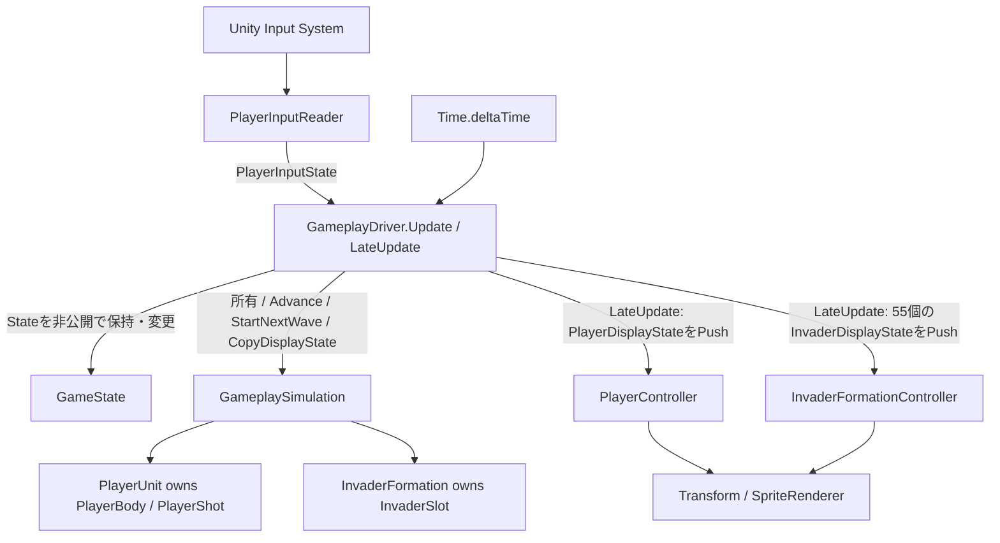

# Architecture

本書は現在の実装構造の正本です。Architectureを変更するときは、実コード・Sceneと一致するよう同じPRで本書も更新します。設計の基準は [PROJECT_PRINCIPLES.md](PROJECT_PRINCIPLES.md)、選択理由は [ADR](adr/README.md) に分けます。

初回作成時のbaselineはPhase 3完了のdevelop（`c36be6c53df104e9ebf0da0600cd6551c0d42f65`、PR #14マージ後）です。Phase 3の固定資料として保存する文書ではありません。

「実装済み」はコード上の構造を示し、原作の厳密な挙動を検証済みという意味ではありません。以下では将来の設計方針と区別します。

## Sceneと起動（実装済み）

Build Settingsの有効Sceneは次の順です。

| Scene | 現在の責務 |
| --- | --- |
| [Bootstrap.unity](../Invader/Assets/Scenes/Bootstrap.unity) | [Bootstrap](../Invader/Assets/Scripts/Bootstrap.cs) のStartでArcadeをSingleロードする起点。現状は永続サービスを生成・保持しない |
| [Arcade.unity](../Invader/Assets/Scenes/Arcade.unity) | GameState、Playingの進行、Player・Shot・Formationの表示、カメラを配置する |

Attract〜GameOverを一台の筐体としてArcade内で扱う設計です。[SampleScene](../Invader/Assets/Scenes/SampleScene.unity) は残っていますが、この起動経路には含めません。HighScore保存や設定サービスは未実装です。

## GameState

[GameState](../Invader/Assets/Scripts/GameState.cs) は次の6値です。

| State | 現在の実装範囲 |
| --- | --- |
| Attract | 初期値の仮置き。待機デモ・Credit・Start受付は未実装 |
| PlayerReady | 値のみ。開始表示・通常の開始遷移は未実装 |
| Playing | Player移動、単一Shot、Formation、命中・撃破・Score、全滅検出 |
| PlayerDead | 値のみ。被弾・死亡・残機・交代は未実装 |
| WaveClear | 全滅後に通常更新を止め、暫定1秒待機して次Waveへ進む |
| GameOver | 値のみ。終了表示・セッション終了は未実装 |

[GameplayDriver](../Invader/Assets/Scripts/GameplayDriver.cs) が現在StateとGameplaySimulationを非公開で所有します。State変更もDriver内部の責務で、通常ランタイムへGetterやChangeState APIを公開しません。完全な遷移規則の検証や未実装Stateの処理を追加したものではありません。

PlayerSelectを独立Stateにせず、Attract中の1P/2P Start入力で参加人数を決める設計方針です。この開始処理自体は未実装です。Creditも独立Stateとして実装していません。

ArcadeのGameplayオブジェクト上のGameplayDriverには開発用 `_developmentStartPlaying` が有効で、Start時にPlayingへ進みます。原作の開始手順ではありません。無効ならAttractのままです。実装済みの通常進行は **Playing → WaveClear → Playing（次Wave）** です。

## Playingの責務と依存

| 要素 | 現在の責務 |
| --- | --- |
| [GameplayDriver](../Invader/Assets/Scripts/GameplayDriver.cs) | Unity側のゲーム全体の実行制御を担う唯一のドライバ。現在State・GameplaySimulation・両表示Controllerを非公開で保持し、Stateを内部で変更する。PlayerInputReaderを所有し、Updateで1描画フレームに1回Advanceする。全滅通知を受けてState変更とWaveClear待機を行う。LateUpdateで値の表示データをPushする |
| [GameplaySimulation](../Invader/Assets/Scripts/GameplaySimulation.cs) | Unity非依存。経過時間を60Hz tickへ分解し、Player・Shot・Formation・Collision・Score・Wave番号と次Wave初期化を管理する。可変モデルは返さず、表示バッファへ不変の値を書き出す |
| [PlayerUnit](../Invader/Assets/Scripts/PlayerUnit.cs) / [PlayerBody](../Invader/Assets/Scripts/PlayerBody.cs) / [PlayerShot](../Invader/Assets/Scripts/PlayerShot.cs) | Player移動と単一Shotのルール。GameplaySimulationはPlayerUnit.Tickを使う |
| [InvaderFormation](../Invader/Assets/Scripts/InvaderFormation.cs) / InvaderSlot | 5×11の55slot、Alive、共通位置・方向・移動step・A/Bアニメを保持する。個体ごとに独立移動しない |
| [PlayerController](../Invader/Assets/Scripts/PlayerController.cs) | PlayerDisplayStateを受信してPlayerとShotの表示を同期。Shotの矩形Spriteを初回配信時に生成する。Driver・Simulation・モデルを保持も検索もしない |
| [InvaderFormationController](../Invader/Assets/Scripts/InvaderFormationController.cs) | 初回配信で55個の表示を生成し、InvaderDisplayStateの値だけから位置・Sprite・表示可否を同期。Driver・Simulation・モデルを保持も検索もしない。撃破後・次Wave・再Enableでも同じRendererを再利用する |
| [ArcadeViewport](../Invader/Assets/Scripts/ArcadeViewport.cs) | カメラ表示領域を224:256に保つ表示側の調整 |

PlayerUnit.Advanceと [InvaderFormationSimulation.Advance](../Invader/Assets/Scripts/InvaderFormationSimulation.cs) は単独モデルの回帰検証用です。実際のPlayingではそれぞれの独立時計を回しません。

### 表示とカプセル化

Driver.Updateで入力・tick・State遷移を進め、Driver.LateUpdateで表示値を生成して両ControllerのApplyDisplayへPushします。初期表示はStartでも配信します。PlayerDisplayStateとInvaderDisplayStateは可変モデル参照を含まないreadonly structです。Driverの55要素バッファとFormation表示側のキャッシュ配列は再利用し、毎フレーム新しい配列・List・InvaderSlotを渡しません。Formationへの配信はReadOnlySpanで同期的に渡し、表示側が自分のバッファへ値コピーします。

表示Controllerは受信値だけをキャッシュし、独自のUpdate / LateUpdateやDriver検索を持ちません。DisableでRendererを隠し、再Enableで最新のキャッシュから表示を復帰します。DriverはDisable時に蓄積時間を破棄して最終表示値を配信し、以後Simulationを進めません。非Playingの表示可否もDriverが渡す値に含めます。

PlayerUnitのBody・Shot、GameplaySimulationのPlayerUnit・Formation、InvaderFormationのSlot配列は非公開です。PlayerUnit.CaptureStateやInvaderFormation.CaptureInvaderは不変の値だけを返し、所有者内部の更新・Collisionと表示生成に使います。単独検証用InvaderFormationSimulationもFormation実体を公開しません。

Editor検証はAssets/Editorから、必要な箇所だけ#if UNITY_EDITORのEditorCapture / EditorSetState / EditorPrepareShot / EditorDeactivateShot / EditorAdvanceFixture等を利用します。観測は値スナップショット（Slotもreadonly structの要素を複製）で、Simulation・Body・Shot・Formationの実体は返しません。通常ランタイム処理はEditor専用APIを呼びません。境界と判断理由は [ADR-0007](adr/0007-push-display-and-encapsulation.md) を参照してください。

### 時間と入力

[PlayerInputReader](../Invader/Assets/Scripts/PlayerInputReader.cs) はInput Systemの左右矢印・Spaceを、Space Invaders専用の [PlayerInputState](../Invader/Assets/Scripts/PlayerInputState.cs)（Left / Right / Fireのbool）へ変換します。Credit・Start・Gamepad入力は未実装です。

GameplaySimulationは1/60秒ごとに以下を実行します。1描画フレームで複数tick進む場合も、この順序をtickごとに守ります。

1. Player移動
2. Shot発射・移動・画面外処理
3. Formation移動・A/B更新
4. 論理Collision・撃破・Score加算・全滅検出

Fireはtick間の入力変化も保持できるよう描画フレームごとに取り込み、発射はtickで処理します。単一ShotがActive中の押下も消費し、再発射にはreleaseと再押下が必要です。

非Playingでは入力取り込みと通常モデル更新を止め、蓄積時間を破棄します。モデルは保持し、Player・Shot・Formationの表示は隠します。WaveClearRequiredが立った場合も残りtickを進めません。

WaveClearの暫定1秒待機とGameState変更はGameplayDriverにあります。Waveのルールすべてが通常C#側に移っているわけではありません。待機終了時にStartNextWaveを呼び、Playingへ戻します。そのフレームは新Formationを初期状態で表示し、進めません。

### 座標・命中・表示

論理画面は **224×256、左下原点**。モデルの論理ピクセル座標が正で、表示時に `(X - 112, Y - 128)` へ変換します。Transformは表示出力であり、ゲームルールへ読み戻しません。PPUやSpriteの表示倍率は表示側の設定です。

CollisionはGameplaySimulationの論理矩形判定です。Transform、SpriteRenderer.bounds、Unity Physicsは使いません。Aliveだけを下段→上段、各行左→右で判定し、1 Shotは最初の1体だけを撃破します。ScoreはTop=30 / Middle=20 / Bottom=10の整数論理値で、HUDは未実装です。

移動速度、初期配置、左右端、HitBox、WaveClearの1秒は暫定です。60Hzという更新基盤の採用は、これらの数値や原作の厳密なタイミングを確認したことを意味しません。

## データ寿命：設計方針と実装の対応

以下の層は所有範囲を考える方針で、同名のクラス群が実装されているわけではありません。

| 層 | 設計方針 | 現在の実装状況 |
| --- | --- | --- |
| Application | HighScore・設定・共通サービスをSceneを跨いで保持し、必要なら永続保存 | 未実装。BootstrapはArcadeロードのみ |
| Arcade Session | Credit・1P/2Pモード・Current Player・セッション進行 | 未実装。現在はArcadeのGameplayDriverが1つのGameplaySimulationを保持 |
| PlayerSlot | 各Player参加中のScore・Lives・Wave・保持が必要と確認された盤面情報 | PlayerSlot・2P退避復元は未実装。ScoreとWaveNumberは現在GameplaySimulationにある |
| Active Wave / Playfield | 現在プレイ中のPlayer・Formation・Shield・UFO等の実行状態 | Player・Formationは実装済み。次WaveではFormationだけを交換。Shield・UFOは未実装 |
| Transient | Shot・爆発・得点表示等の短命な状態。原則永続化しない | 単一PlayerShotのみ実装。オブジェクトは再利用し、Activeで弾の寿命を表す。爆発・得点表示は未実装 |

現在の次Wave初期化は、Formationを55体Aliveの初期状態に置き換え、WaveNumberを増やし、全滅通知と蓄積時間をリセットします。Score、Player（Xを含む）、単一PlayerShot（FireReady / release待ちを含む）は保持します。WaveClear中は入力を消費しないため、その間のreleaseだけでは再発射可能になりません。

これは現在の単一モデルによるWaveループで、PlayerSlotやセッションの寿命管理全体を実装したものではありません。

## 検証と更新

既存のロジック・Play Mode検証は [Assets/Editor](../Invader/Assets/Editor) にあり、実行方法と操作確認は [README](../README.md) を参照してください。文書のコード照合とUnityでの実行確認は分けて報告します。

責務境界を変更するときは本書を更新し、新しい重要判断があれば [ADR運用](adr/README.md) に従います。未実装の設計方針は、実装された時点で対応関係を更新します。
