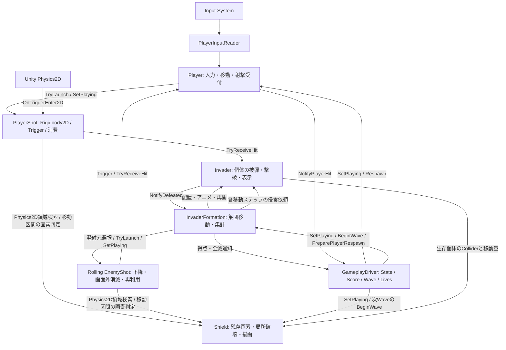

# Architecture

現在のコード構造の正本です。判断基準は [PROJECT_PRINCIPLES](PROJECT_PRINCIPLES.md)、変更理由は [ADR-0008](adr/0008-component-gameplay.md) を参照します。

## 移行状態と起動

Issue #57でPlayingのコードをComponent/Physics2Dへ移行し、現在はArcade SceneとGameplay Prefabを保存済みです。Issue #59ではRolling敵弾をEditor APIで追加し、Unity 6000.6.4f1の非表示バッチで限定Play確認を実施しました。Scene/PrefabのYAMLは直接編集していません。

通常は保存済みBootstrapから起動します。Scene再生成が必要な場合の移行メニューは [README](../README.md) を参照してください。

| Scene | 役割 |
| --- | --- |
| Bootstrap | StartでArcadeをSingleロード。今回変更なし |
| Arcade | Driver、Player、単一PlayerShot、Formation、単一Rolling EnemyShot、Shield4基、カメラ |
| SampleScene | 既存サンプル。今回変更なし |

1P専用・クレジットなしです。Issue #61のPlayer被弾、Issue #63のLives・復帰・GameOverに加え、Issue #69でShield4基の弾による画素破壊とWave復元、Issue #71でInvader Colliderによる画素侵食を追加しています。待機デモ・開始/リトライ・追加残機/Lives HUD・UFO・HighScore保存、Rolling以外の敵弾と弾の相殺、Invader侵攻による敗北条件は未実装です。検証状況は [Lives・復帰](LIVES.md) と [Shield](SHIELDS.md) を参照してください。

## Playingの責務

| Component | 所有する責務・状態 |
| --- | --- |
| GameplayDriver | 現在State、Score、Wave番号、Lives。WaveClearの暫定1秒待機とPlayerDeadの暫定0.5秒待機。次Wave・復帰/GameOverを管理 |
| Shield | 各基の画素占有を所有し、描画・穴通過・方向別局所破壊を担当。弾の移動区間とInvader Colliderのswept boundsを既存Triggerで検索し、残存画素を判定・消去。死亡・停止時は保持、次Waveで初期画像から復元 |
| DebugCarpetBomb | Editor/Development Build限定のB長押し入力、専用PlayerShot 96発の遅延生成・再利用、23レーンの一巡シャッフル。DriverのState/Waveを読み、非Playing・Driver無効・Wave変更・自身の無効化で専用弾を回収。通常自機弾と独立し、命中・Score・全滅・Wave進行は既存Componentへ任せる。製品ビルドにも型とScene参照は残すが入力・生成処理は含めない |
| DebugStatusOverlay | ArcadeのDriverと同じGameObjectで、State・Lives・Waveの読み取り専用enum/intを描画時に取得。状態の複製や進行操作を行わず、非Playingでも表示。OnGUIによる開発用表示はEditor/Development Buildのみ有効で、Componentの型は製品ビルドにも残す |
| Player | InputReader、入力値と発射受付、release/再押下ゲート。Transformで移動し被弾をDriverへ通知。復帰時に自身の位置・受理/発射ゲートと自機弾を初期化 |
| PlayerShot | 動的Rigidbody2DとTrigger。自身の接触をInvaderへ渡し、命中成立後に非アクティブ化して消費。画面上端でも消費 |
| Invader | GameObjectの有効状態による生死、Spriteの2コマ、被弾反応、所属Formationへの一度だけの通知 |
| InvaderFormation | Kinematic Rigidbody2D、55個のInvader参照、集団移動の方向/周期/アニメ位相、生存数の集計。通知からDriverへ得点・全滅を伝える |
| EnemyShot | Kinematic Rigidbody2D、下降周期と速度区分。TriggerでPlayerへ被弾受付を依頼し、成立時または画面下端で非アクティブ化して再利用 |
| ArcadeViewport | 224:256の表示領域と論理px→Unity単位の倍率 |

`GameplaySimulation`、`PlayerUnit`、`PlayerBody`、`InvaderSlot`、`InvaderFormationSimulation`、旧表示Controller2種、表示/検証スナップショットは削除しました。互換モデルや旧AABB判定は残しません。管理Componentや配列を返すGetterもありません。

## 状態の正とPrefab

位置はPlayerのTransform、ShotとFormationのRigidbody2Dにあります。InvaderはFormation配下のTransformとGameObject有効状態を正とし、別のX/Y・Aliveモデルを持ちません。Formationの `_aliveCount` は個体からの通知で更新する集計値です。Editor検証の観測にはSerializedObjectを使い、検証用のランタイムGetterは追加しません。開発用オーバーレイにはDriverの`CurrentState`・`Lives`・`WaveNumber`の読み取り専用propertyを使い、管理Componentは公開しません。

Player、Shot、InvaderのPrefabを `Assets/Prefabs/Gameplay/` にEditor APIで生成します。PlayerのShot参照はArcadeのPrefab instance overrideです。ShotはPlayerの子にせず、発射後のXがPlayerの移動へ追従しないようにします。

Invaderは5×11個を一度生成し、次Waveでも同じ個体・Rendererを再利用します。行ごとのSpriteは既存のTop/Middle/Bottom A/Bを渡し、画像全体の比率を維持します。表示用の子Visualだけを縮小し、親Colliderの寸法を変えません。ShotもBorder不要のSimple表示です。

## 入力・更新・停止

- Player.Update：左右矢印・Spaceを読む。押しっぱなしでは再発射せず、飛行中の押下も消費する。短い押下は次のFixedUpdateまで保持する。
- Player.FixedUpdate：60px/秒相当で左右移動し、端でclamp。受付済みの発射を行う。左右同時押しは従来どおり右優先。
- Formation.FixedUpdate：20/60秒ごとに2px横移動。端では8px下降・方向反転し、全個体のA/Bを交換する。
- Shot：Rigidbody2Dが240px/秒相当で上昇。FixedUpdateで画面上端を確認し、OnTriggerEnter2Dで接触対象を処理する。
- Driver.Update：WaveClear待機とPlayerDead待機。次WaveではLives・Score・Player位置・Shot占有・releaseゲートを保持し、編隊を初期化する。死亡からの復帰では編隊を初期化しない。

Unityの既存Fixed Timestep（0.02秒）を使い、ProjectSettingsは変更しません。独自60Hz時計や「Player→Shot→Formation→Collision」の旧tick順序は廃止しました。速度・周期は従来相当に換算しますが、接触タイミング・境界・端の到達frameは厳密一致を保証せず、描画FPS別の実測も未確認です。

非Playing・Driver無効時はPlayer移動/射撃とFormation更新を止め、表示とCollider/物理シミュレーションを停止します。既存Shotの位置・占有と個体の生死は保持します。停止時は未実行入力とFormationの経過時間を破棄し、再開時に停止時間を取り戻しません。Player単体のDisableでも自身とShotを、Formation単体のDisableでも配下の表示・物理を停止します。

## 座標・命中・進行

論理画面は従来どおり224×256です。**1論理px＝0.01 Unity単位**、画面中心がUnity原点です。論理座標との対応は `((x - 112) * 0.01, (y - 128) * 0.01)`。物理速度を小さなUnity単位で扱い、ProjectSettingsの速度制限を変更しません。カメラのOrthographic Sizeは1.28です。

- Player初期位置：(112,24)、移動範囲x=8〜216、Sprite幅16px。
- Shot：幅1×高さ4px。位置は下端中央、発射位置はPlayerの8px上、Collider中心は下端から2px上。
- Formation左上初期位置：(32,208)、間隔16px、Colliderは16×8px。Spriteは既存480×241/PPU30の約16×8.03pxの比率を維持。
- Score：Top=30、Middle=20、Bottom=10。55体の合計は990。Driverが通知の受理時に加算する。HUDは未実装。

Shotが処理中ガードを立ててInvaderに命中を依頼し、Invaderは受理時に直ちにGameObjectを無効化して通知します。Shotも命中成立後に無効化するため、同じ弾の後続通知や同じ個体への別弾は再撃破・再加点しません。最終撃破の通知でDriverは即座に全Componentを停止します。

隣接2体への同時接触は最大1体だけを撃破しますが、どちらが選ばれるかは保証しません。旧独自判定の下段→上段・左→右の優先順位は再現しません。Discrete Triggerと固定物理stepを使うため、高速化時のすり抜け・接触境界の差はローカルで確認が必要です。移動速度・初期位置・WaveClearの1秒等は既存の暫定値を継承しています。

## 検証の範囲

### Player被弾（Issue #61）

EnemyShotは自身のOnTriggerEnter2Dで接触を検出し、PlayerがPlaying・Collider有効・未受理を確認して被弾を成立させます。DriverはPlaying中の通知だけでLivesを1機減らしてPlayerDeadへ遷移します。Playerの受理ガードは復帰時だけ解除します。EnemyShotは処理中ガードと非アクティブ化で重複接触を抑止します。

PlayerDeadでは既存SetPlaying(false)で入力・射撃・編隊・弾の物理と表示を止め、Player Colliderも無効化します。暫定0.5秒後、Livesが残ればPlayer自身のRespawnで初期位置(112,24)へ戻し、旧自機弾・入力・受理ガードを初期化してPlayingへ直接戻ります。Formationは旧Rolling弾と発射タイマーだけを解除し、位置・方向・生存個体・アニメとScore/Waveは保持します。0機ならGameOverで停止し、Attractへは戻りません。詳細は [Lives・復帰](LIVES.md) を参照してください。

### Rolling EnemyShot（Issue #59）

FormationがPlayerのTransformと再利用するEnemyShotを参照し、Playing中にPlayer対応列の最下段の生存Invaderから発射を依頼します。EnemyShotはKinematic Rigidbody2Dで0.05秒ごとに4px、残数8以下で5px下降し、画面下端で非アクティブ化します。DriverのScore/WaveとPlayerShotの既存経路は維持します。発射間隔2秒・橙色3×8px矩形は暫定仕様です。

Scene参照・Prefabは保存済みです。専用の非表示バッチで発射・速度切替・停止・下端消滅・発射元不在・次Wave再利用・既存PlayerShotの接触/加点を確認しました。描画の目視や実キー操作は未確認です。詳細は [Rolling EnemyShot](ROLLING_ENEMY_SHOT.md) を参照してください。

旧モデル・旧Push専用のEditor検証と旧設定ツールは削除しました。代わりに接続・物理設定・Missing Script・Play中の55体と生存集計を確認する `Verify Component Gameplay Setup`、Editor限定の一時停止/再開メニュー、READMEの最小限の操作確認を用意しています。接続チェックは衝突やWave進行の成功を意味しません。

Scene/Prefab移行・Unityコンパイル・Play動作の実行状況はPR本文を参照してください。独立PoC [Physics2DProbe](../Invader/Assets/Prototypes/Physics2DProbe/README.md) は今回変更せず、本編から参照しません。
